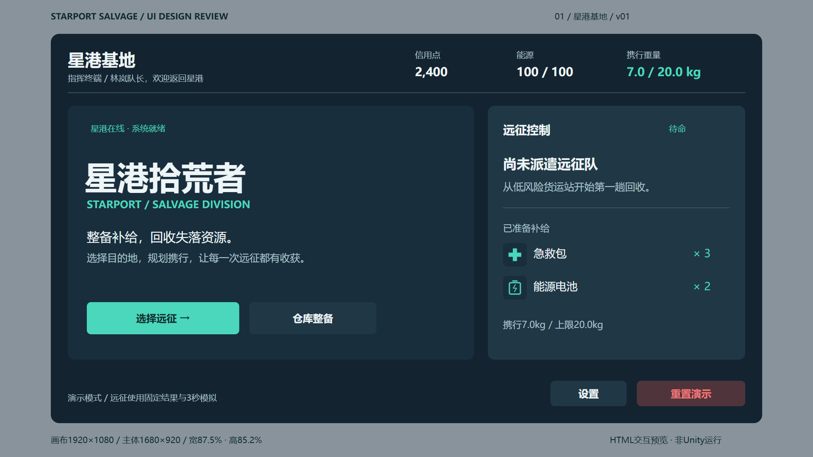
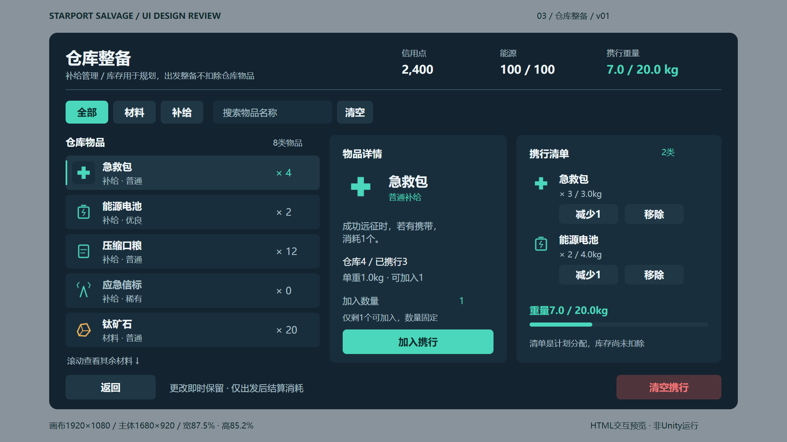
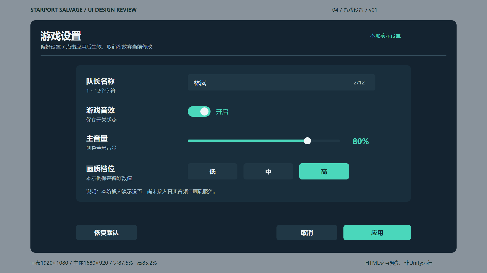

# HTML to Unity UGUI Workflow

[简体中文](README.md) | [English](README.en.md)

[](https://github.com/xzzhuu/html-to-unity-ugui-workflow/actions/workflows/verify.yml)
[](LICENSE)

A reusable workflow from UI requirements and layout review to browser-previewable XHTML and native Unity UGUI / TextMesh Pro prefabs.

This repository includes a Codex Skill, a complete six-panel Starport example, Python tools, and the complete source for the `com.nex.html-to-ugui` 0.3.0 UPM package. Design source files stay outside the Unity project. The importer creates image assets, Panel / Item prefabs, and generic binding metadata; the receiving application implements its own data handling and interactions.

## Features and boundaries

- Initialize a standard HTML UI workspace while preserving existing files on repeated runs.
- Describe each element's purpose, semantic name, parent, native component, binding, and dynamic Item template.
- Validate XHTML, assets, manifests, approval records, and readiness status.
- Import prepared XHTML and PNG assets as native UGUI/TMP Panel and Item prefabs.
- Scan a project directory, review selected panels together and batch-import them under `Assets/HtmlToUGUIStage/{ProjectName}/{PanelName}/`, with project-grouped previews. See the [project import workflow](Packages/com.nex.html-to-ugui/README.md#import-a-project-containing-multiple-panels).
- Support browser previews and structural validation. The importer supports a limited CSS subset and does not guarantee faithful conversion of arbitrary web pages.

The Starport example follows the complete requirements → approved panel and element previews → shared assets → HTML → staged Unity → formal copy workflow. See the [walkthrough](docs/game-example/workflow.md) and [visual verification rules](docs/game-example/conversion-rules.md). Browser JavaScript remains preview logic; gameplay integration is separate.

## Starport previews

| Home | Inventory | Settings |
| --- | --- | --- |
|  |  |  |

Actual HTML browser captures at 1920 × 1080. Unity verification is recorded separately.

## Quick start

Requirements: **Python 3.10+**. Unity import requires **Unity 2022.3**, UGUI 1.0.0, and TMP 3.0.7. Opening the HTML examples in a browser does not require Unity.

```sh
git clone https://github.com/xzzhuu/html-to-unity-ugui-workflow.git
cd html-to-unity-ugui-workflow
python -m http.server 8148 --bind 127.0.0.1 --directory Workspaces/StarportSalvage
```

Open the [Starport launcher](http://127.0.0.1:8148/index.html). New workspaces initialized with the Skill remain unapproved drafts.

### Install the Codex Skill

Choose either installation method below.

**Option 1: Install with npx (no manual repository clone required)**

Requires Node.js / npm and Git. Use the [Skills CLI](https://github.com/vercel-labs/skills):

```sh
npx skills add https://github.com/xzzhuu/html-to-unity-ugui-workflow/tree/main/Skills/ui-panel-design-to-html --agent codex --global --copy
```

`--agent codex` targets Codex, `--global` installs at user scope, and `--copy` copies the complete Skill without requiring symlinks. The Skills CLI manages installation paths and updates. This installs only the Skill, not the Unity package. The Skill's Python tools still require Python 3.10+.

**Option 2: Use the repository installer after cloning**

Run from the repository root:

```sh
python -X utf8 Tools/install-global-skills.py
```

The default destination is `~/.codex/skills`. The installer supports `CODEX_HOME` and `--destination`, updates files it manages, and preserves unknown user files. It also removes retired workflow Skills previously managed by this installer.

In a new Codex task, invoke the Skill to initialize a workspace:

```text
$ui-panel-design-to-html Initialize the current directory as a new HTML UI workspace.
```

For a full UI design task:

```text
$ui-panel-design-to-html Create a UI Panel from the requirements and reference images. First provide a layout image and an element completeness checklist for my review.
```

The Skill's instructions and supporting reference documents are currently primarily in Chinese. The CLI commands can be used independently of Codex. The formal design workflow requires explicit layout approval before component breakdown and final HTML implementation.

### Install the Unity importer

In Unity Package Manager, choose **Add package from disk** and select `Packages/com.nex.html-to-ugui/package.json` from this repository.

Alternatively, choose **Add package from git URL** and enter:

```text
https://github.com/xzzhuu/html-to-unity-ugui-workflow.git?path=/Packages/com.nex.html-to-ugui
```

Import TMP Essential Resources and select a TMP font containing the required glyphs. Then choose **Tools → HTML to UGUI → 导入单个面板...** and select a prepared HTML file outside the Unity project.

Generation defaults to `Assets/HtmlToUGUIStage/{PanelName}/`. Review panels in `Assets/HtmlToUGUIStage/StageScene.unity` using **Tools → HTML to UGUI → 面板暂存与复制...**, check the panels you want, inspect the copy plan, then copy them to formal folders. The default-enabled **保留面板名称子目录** option puts main Prefabs in `Assets/Art/UIPrefab/{PanelName}/`; disable it to put them directly in `Assets/Art/UIPrefab/`. Both modes put Item Prefabs in `Assets/Art/UIPrefab/Item/`; images go to `Assets/Art/UI/Sprites/{PanelName}/`. Reports remain in staging, and fonts/materials reuse existing project resources. See [promotion options and examples](docs/stage-promotion.md) and the [package guide](Packages/com.nex.html-to-ugui/README.md) for input requirements, outputs, and conversion limits.

### Open the sample Unity project

Open `UnityProject/` with Unity 2022.3. Its package manifest references the importer within this repository, so it does not require the original author's local package paths. Unity MCP is an optional local development dependency; remove or adjust its local file reference when using another machine.

Third-party fonts, TMP Essential Resources, and vendor examples are not distributed. Before using the sample scenes and prefabs:

1. Choose **Window → TextMeshPro → Import TMP Essential Resources**.
2. Prepare a TMP font covering the required characters, including Chinese text where applicable, under an appropriate license.
3. Import the game root `Workspaces/StarportSalvage` after selecting the project TMP default font. This project uses the existing `PICOSansVFESC SDF` and its shared material.
4. Check the Console, scene, and prefabs, then save the scene.

Existing prefab font references may be missing until reimport. The original sample project used `2022.3.62f3c1`; compatibility with other 2022.3 patch versions has not been reverified. See the [sample project notes](UnityProject/README.md) for details; those notes are currently in Chinese.

## Test project and game workspace

Open `UnityProject/` inside your clone with Unity 2022.3.62f3c1. It references the repository UPM package using a relative path. Restore the licensed font/TMP resources and adjust the optional local Unity MCP dependency as described in the [project notes](UnityProject/README.md). The editor's buttons, window labels, and menu entries use Chinese.

The [Starport workspace](Workspaces/StarportSalvage/README.md) stores every panel package under `Workspaces/StarportSalvage/Panels/{PanelName}/`. Keep `project.assets.json`, shared assets, design reviews, and tools at the game root. Select that root for project import; each panel package resolves it with `projectDirectory: "../../.."`. The initializer detects this layout when the root asset manifest exists.

## Repository structure

| Directory | Purpose |
| --- | --- |
| [Skills/ui-panel-design-to-html](Skills/ui-panel-design-to-html/SKILL.md) | Workflow Skill, contracts, scripts, and editable workflow diagrams |
| [Packages/com.nex.html-to-ugui](Packages/com.nex.html-to-ugui/README.md) | Unity Editor importer and generic Runtime metadata |
| [Tools](Tools/README.md) | Installation, validation, layout comparison, and packaging tools |
| [Workspaces](Workspaces/README.md) | Game-wide shared assets, panel sources under Panels/, and review evidence |
| [UnityProject](UnityProject/README.md) | Unity 2022.3 sample project; font resources must be restored separately |
| [Audit](Audit/README.md) | Public distribution notes; machine-specific run results are excluded from Git |

Supporting documentation outside the package guide is currently primarily in Chinese.

## Validation and packaging

Run these commands from the repository root:

```sh
python -m pip install -r requirements-dev.txt
python -B -X utf8 -m unittest discover -s Skills/ui-panel-design-to-html/scripts -p test_workflow.py
python -X utf8 Tools/verify-directory-generator.py
python -X utf8 Tools/verify-preparation-contract.py
python -X utf8 Tools/verify-installer.py
python -X utf8 Tools/verify-workflow-files.py
python -X utf8 Tools/verify-file-integrity.py
python -X utf8 Tools/build-unity-package.py
```

Package archives and file-by-file verification reports are written to `dist/`. Validation reports are written to `Audit/Runs/latest/`. Both directories are excluded from version control.

GitHub Actions runs these checks on Windows and Ubuntu with Python 3.10 and 3.12, and uploads package artifacts. A separate browser job runs the Starport interactions using `npm ci`, `npx playwright install chromium`, and `npm run verify:browser`. **These checks do not compile the Unity project or perform visual acceptance testing.** After restoring the actual Unity project resources, run `python -B -X utf8 Tools/verify-starport-panels.py --unity-project UnityProject` to check all six panels, Items, images, fonts, and delivery fingerprints. Importer changes still require verification in Unity Editor.

## Contributing and license

Read the [contribution guide](CONTRIBUTING.md), [code of conduct](CODE_OF_CONDUCT.md), [security policy](SECURITY.md), and [changelog](CHANGELOG.md). Report bugs and propose features through GitHub Issues. For importer bugs, provide a minimal prepared XHTML example and identify whether the problem affects browser preview, Python validation, or Unity import.

For sensitive security issues, use [private vulnerability reporting](https://github.com/xzzhuu/html-to-unity-ugui-workflow/security/advisories/new) rather than publishing credentials or private project data in an Issue.

This project is distributed under the [MIT license](LICENSE). Third-party dependencies, fonts, and Unity software retain their own licenses; see [third-party notices](THIRD_PARTY_NOTICES.md).

Project author: **Nex Xie**. The root `.mailmap` normalizes historical author display names by email; published commit objects and SHAs are preserved.
